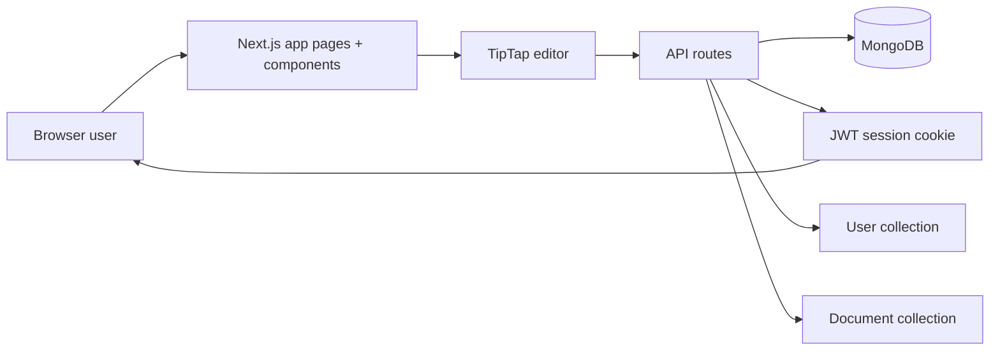

# Architecture

## Framework and app structure

This project is a Next.js application using the App Router. The main pieces are:

- `src/app/page.tsx`: redirects to the dashboard if a user session exists; otherwise pushes the login page.
- `src/app/login/page.tsx`: shows demo-user login options.
- `src/app/docs/[id]/page.tsx`: loads a document for a logged-in user and renders the editor.
- `src/components/Workspace.tsx`: dashboard for creating, listing, searching, importing, renaming, and deleting documents.
- `src/components/DocumentEditor.tsx`: rich-text editor, toolbar, autosave, ownership state, and per-document sharing UI.
- `src/components/ShareDialog.tsx`: owner-only access-management dialog.

The application uses TypeScript, React 19, and Next 16. Styling is light Tailwind-based utility classes with custom UI states and a simple surface/line palette.

## Frontend and editor

The editor is built with `@tiptap/react` and `@tiptap/starter-kit`.

Key characteristics:

- Only a narrow formatting surface is enabled: bold, italic, underline, H1/H2/H3, bullet lists, and numbered lists.
- Unsupported nodes and marks are blocked in a server-side sanitizer so imported or malicious JSON is stripped before storage.
- Autosave is debounced at 800 ms and uses a `baseVersion` conflict check to avoid overwriting newer saves.
- The editor is read-only for viewers and editable only for owners or editors.
- The exported text action is a plain `.txt` download generated from the TipTap document content.

## API routes and data flow

API routes live under `src/app/api/`:

- `GET /api/documents` and `POST /api/documents`: list/create documents
- `GET /api/documents/:id`, `PATCH /api/documents/:id`, `DELETE /api/documents/:id`: document reads, edits, and deletion
- `POST /api/documents/:id/shares`, `DELETE /api/documents/:id/shares`: owner-only sharing management
- `POST /api/import`: accepts multipart `.txt` or `.md` upload and creates a new document
- `POST /api/auth/login`, `POST /api/auth/logout`, `GET /api/auth/me`: session login/logout
- `GET /api/users`: returns demo users for the login and share dialogs
- `GET /api/health`: basic health check route

The typical flow for a document save is:

1. Browser calls a route from the client (`api()` helper).
2. The route resolves the active user and loads the document with permission checks.
3. The route validates the incoming JSON or form data with Zod and `sanitizeDoc()`.
4. Mongoose updates the MongoDB document.
5. The UI refreshes with the latest metadata and content.

## Database and persistence strategy

Data persistence is MongoDB via Mongoose.

Important implementation details:

- `src/lib/db.ts` caches the Mongoose connection on `globalThis` to avoid reconnecting on hot reloads and serverless-style re-evaluation.
- `src/lib/models/User.ts` stores user records with `name` and `email`.
- `src/lib/models/Document.ts` stores the document `title`, sanitized `content`, `ownerId`, `shares`, and a numeric `version` counter.
- `DocumentSchema.index({ "shares.userId": 1 })` supports listing shared documents quickly.
- `content` is stored as TipTap JSON rather than HTML.

The database is not normalized around multiple document revisions; the app stores only the latest serialized document state and a monotonically increasing conflict-check version.

## Authentication and demo-user strategy

Authentication is a simple session-based system without passwords:

- `src/lib/auth/session.ts` signs a JWT and stores it in an `httpOnly` cookie named `docraft_session`.
- `AUTH_SECRET` is required in `.env.local` and must be long enough.
- `POST /api/auth/login` accepts a valid user ID from `UserModel` and creates the cookie.
- `getCurrentUser()` verifies the token and fetches the user from MongoDB.

This is intentionally a demo-user workflow, not a production auth system. The login page asks the user to choose an existing seeded demo user (`zubia`, `ashraf`, `syeda`).

## Document ownership and sharing permissions

The access model is defined in `src/lib/authz/access.ts`:

- `owner`: read, edit, delete, share
- `editor`: read, edit
- `viewer`: read only
- `none`: no access

The access check is pure and tested independently. The route layer enforces these rules before reads or writes:

- `loadDocument()` hides missing documents behind a 404 if the user does not have access.
- `PATCH` content updates require a matching `baseVersion` for stale-save protection.
- Only owners can share or delete documents.
- Editors can read and patch content but cannot share or delete.

## File import handling

Import is intentionally narrow and safe:

- `Workspace.tsx` allows `.txt` and `.md` files only.
- `POST /api/import` validates file type, size (`500 KB` maximum), and UTF-8 encoding.
- The file is converted through `markdownToDoc()` or `textToDoc()`.
- `sanitizeDoc()` strips unsupported structures and nodes before storage.
- Raw HTML is preserved as plain text, never turned into a live HTML node.

This means import safety favors predictable content rendering over unsupported richness.

## Testing approach

The repository includes automated tests with Vitest:

- `src/lib/authz/access.test.ts`: permission model coverage
- `src/lib/validation/content.test.ts`: sanitization and node validation coverage
- `src/lib/import/convert.test.ts`: Markdown/plain-text conversion coverage

There is also a PowerShell smoke test at `scripts/smoke.ps1` that exercises real HTTP requests against a running dev server, seeded users, and document permissions.

## Trade-offs and deliberate scope cuts

This project intentionally keeps scope narrow so it can be built quickly and documented cleanly:

- No production-grade authentication, password reset flow, or user management.
- No real-time multi-user editing or presence indicators.
- No document version explorer or rollback UX.
- No PDF or richer export formats.
- No additional sharing roles beyond `viewer` and `editor`.
- No multi-tenant or role management beyond document ownership and sharing.

This is a focused assessment app: a document editor with role-checked access, sanitization, and import support rather than a general-purpose collaborative document platform.

